# laby_rinth

## Identitas

- Nama: Edric Roland Li
- NIM: 241401079
- Lab: PM 2

## Informasi Aplikasi

**Nama aplikasi:** laby_rinth

**Deskripsi:** Aplikasi kuis pilihan ganda untuk latihan materi Lab Basis Data. Pengguna mengisi nama dan NIM, menjawab 10 soal, lalu melihat skor beserta pembahasan setiap soal.

**Fitur:**

- Splash screen.
- Isi nama dan NIM sebelum mulai kuis.
- 10 soal diambil acak dari 20 soal (ERD, normalisasi, DDL, DML, JOIN, agregasi, constraint, transaksi). Urutan pilihan jawaban ikut diacak.
- Waktu 30 detik untuk tiap soal.
- Jawaban dipilih dulu, lalu dikirim dengan tombol "Kirim jawaban". Pilihan masih bisa diganti sebelum dikirim.
- Setelah menjawab, langsung muncul benar/salah dan penjelasannya. Kalau waktu habis, kunci jawaban dan penjelasan tetap ditampilkan.
- Halaman hasil berisi nama, NIM, jumlah benar, nilai, dan durasi pengerjaan.
- Review semua jawaban, bisa difilter hanya yang salah.
- Riwayat skor per NIM. Setiap pengerjaan bisa dibuka untuk melihat tanggal, nilai, dan soal mana yang salah.
- Progres kuis tersimpan: tidak hilang saat layar diputar atau pindah halaman, dan bisa dilanjutkan setelah keluar dari kuis.
- Mode terang dan gelap.
- Tampilan menyesuaikan HP (portrait dan landscape), tablet, dan browser.

## Dokumentasi

### Kredit aset

| Aset | Sumber | Lisensi |
|---|---|---|
| Font Nunito | [Google Fonts](https://fonts.google.com/specimen/Nunito) | SIL Open Font License 1.1 (`assets/licenses/Nunito-OFL.txt`) |
| Font JetBrains Mono | [JetBrains](https://github.com/JetBrains/JetBrainsMono) | SIL Open Font License 1.1 (`assets/licenses/JetBrainsMono-OFL.txt`) |
| Ikon | [Phosphor Icons](https://github.com/phosphor-icons/core) | MIT (`assets/licenses/Phosphor-MIT.txt`) |
| Ikon panah buka/tutup | Material Icons (bawaan Flutter) | Apache License 2.0 |
| Logo dan ilustrasi skema | Dibuat untuk aplikasi ini (`assets/images/`) | — |

### Screenshot

| Splash | Home | Identitas |
|---|---|---|
| 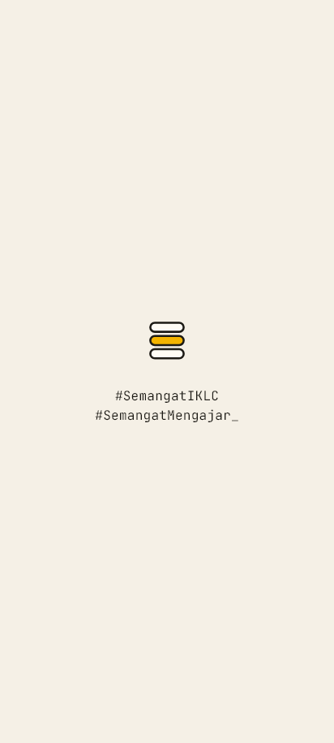 | 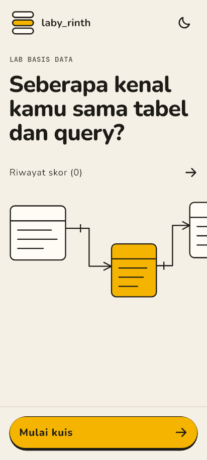 | 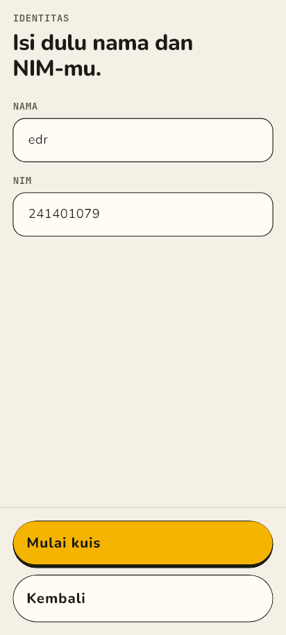 |

| Kuis | Jawaban dipilih | Benar/salah dan penjelasan |
|---|---|---|
| 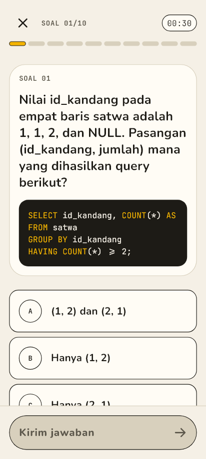 | 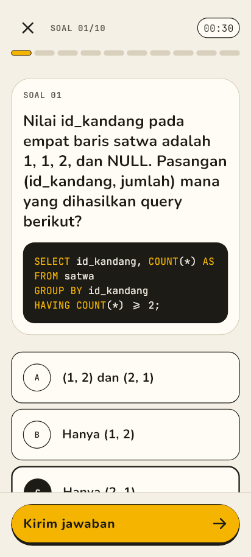 | 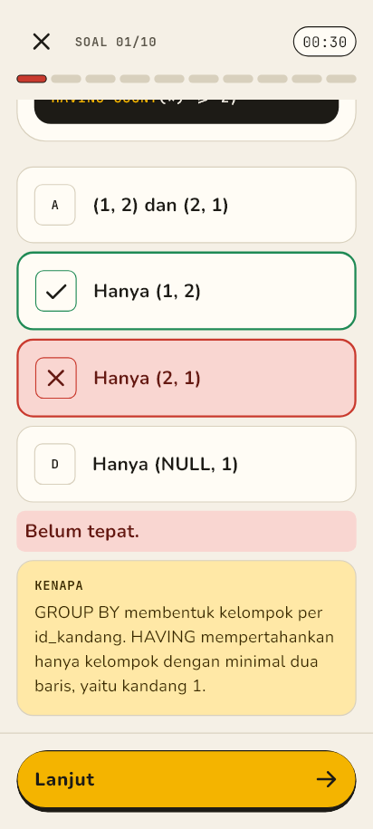 |

| Hasil | Review | Riwayat skor |
|---|---|---|
| 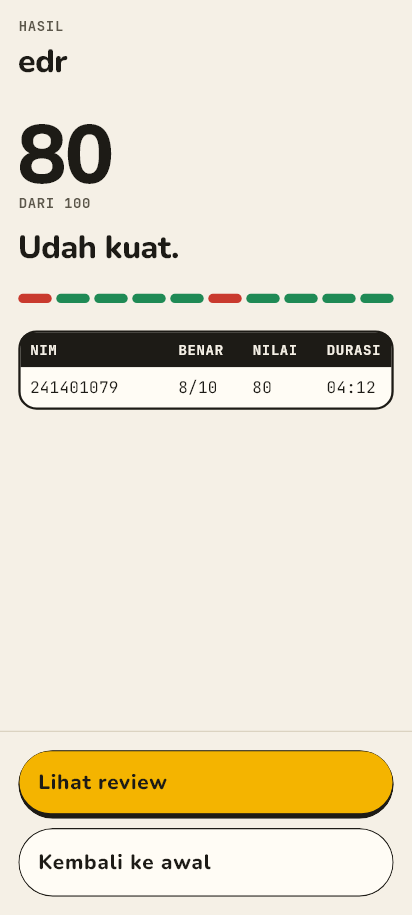 | 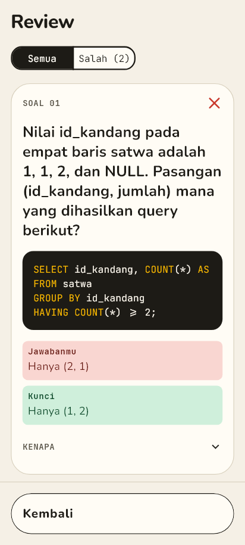 | 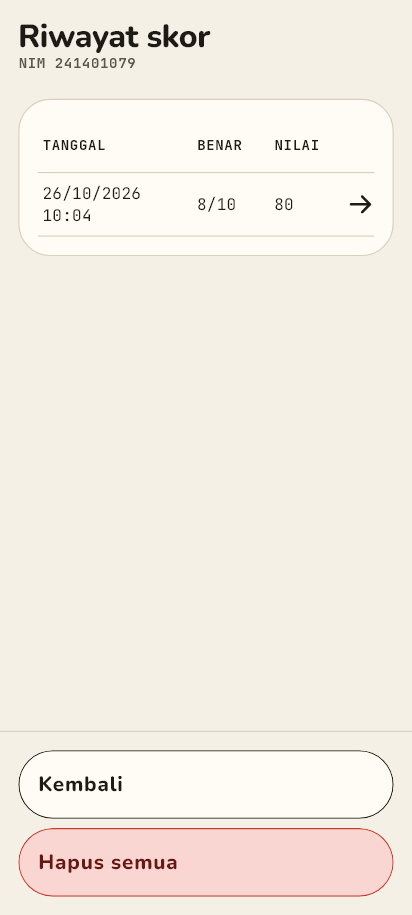 |

| Detail pengerjaan | Home (mode gelap) |
|---|---|
| 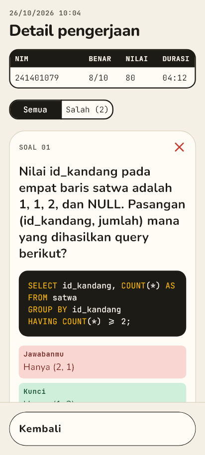 | 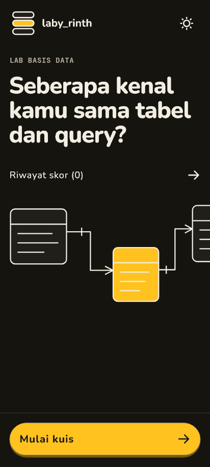 |

**Landscape**

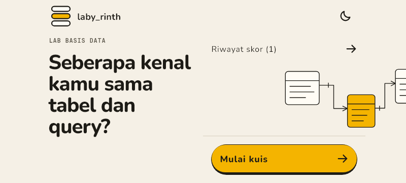

**Tablet**

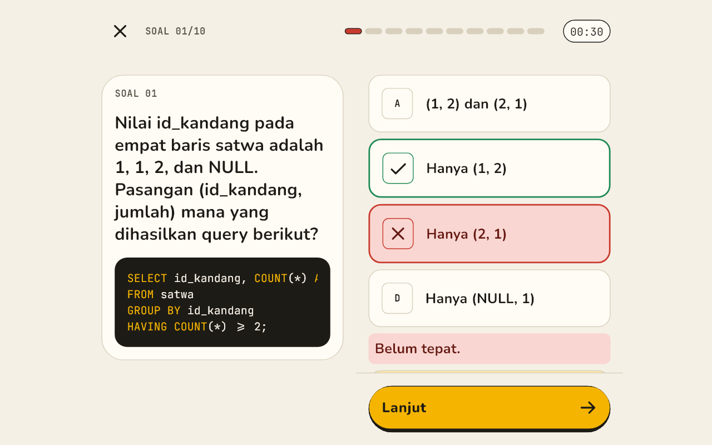

### Mockup / prototype

[Figma laby_rinth](https://www.figma.com/design/DjSudGVr2XsTOGQyw1iZqn/uts_pm2)
